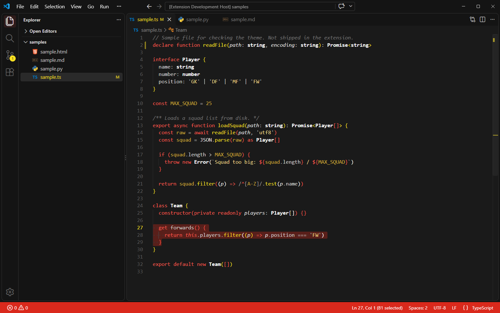
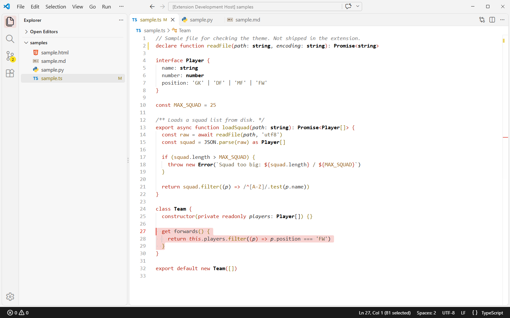
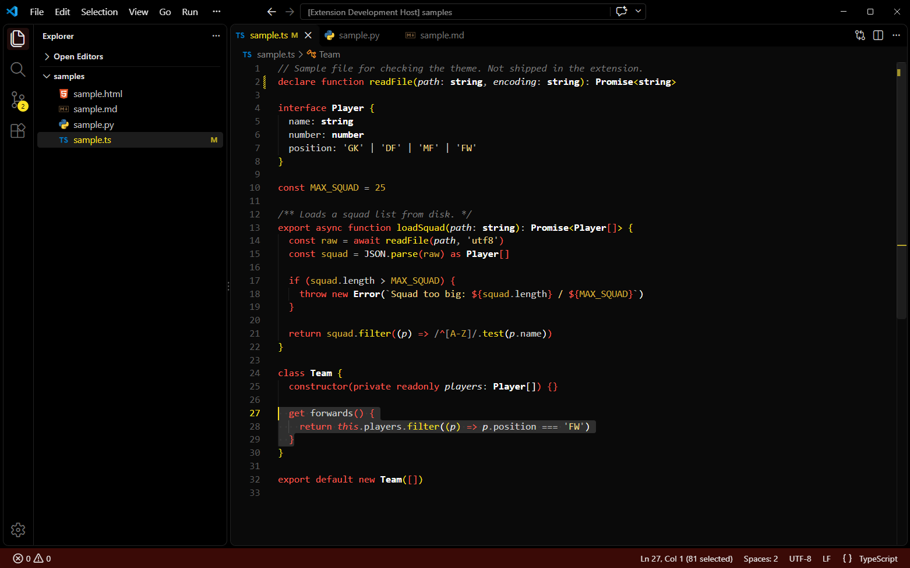

# Red Devils

A bold dark theme for VS Code in red, gold and black. Made by The DevLab.



## Install

1. Open the Extensions view (`Ctrl+Shift+X` / `Cmd+Shift+X`).
2. Search for **Red Devils** and click **Install**.
3. Open the Command Palette, run **Preferences: Color Theme** and pick a variant.

## Variants

| Theme | Style |
|---|---|
| **Red Devils** | Dark, with a red status bar and gold highlights. |
| **Red Devils Light** | White background, red accents and a black status bar. |
| **Red Devils Blackout** | Near-black throughout, with a dark red status bar. |

### Red Devils Light



### Red Devils Blackout



## Palette

| Role | Red Devils | Light | Blackout |
|---|---|---|---|
| Background | `#1A1A1A` | `#FFFFFF` | `#0A0A0A` |
| Sidebar & panels | `#141414` | `#F7F7F7` | `#000000` |
| Text | `#E8E8E8` | `#1A1A1A` | `#E8E8E8` |
| Status bar | `#DA291C` | `#1A1A1A` | `#3A0A06` |
| Cursor | `#FBE122` | `#DA291C` | `#FBE122` |
| Badges | `#FBE122` | `#FBE122` | `#FBE122` |
| Keywords, tags | `#FF5A4E` | `#B8200F` | `#FF5A4E` |
| Functions, attributes | `#FBE122` | `#8A6D00` | `#FBE122` |
| Strings | `#F5D98B` | `#6B5B3A` | `#F5D98B` |
| Numbers, constants | `#D4AF37` | `#9A5B13` | `#D4AF37` |
| Types, classes (bold) | `#FFFFFF` | `#000000` | `#FFFFFF` |
| Comments (italic) | `#7A7A7A` | `#767676` | `#7A7A7A` |

## Development

Press F5 in VS Code to open a test window with sample files. The Blackout variant is generated from the main theme; after changing `themes/red-devils-color-theme.json`, run:

```powershell
powershell -File scripts/make-blackout.ps1
```

## Feedback

Spotted something that looks off in your language? Open an issue with a screenshot.

## License

MIT
